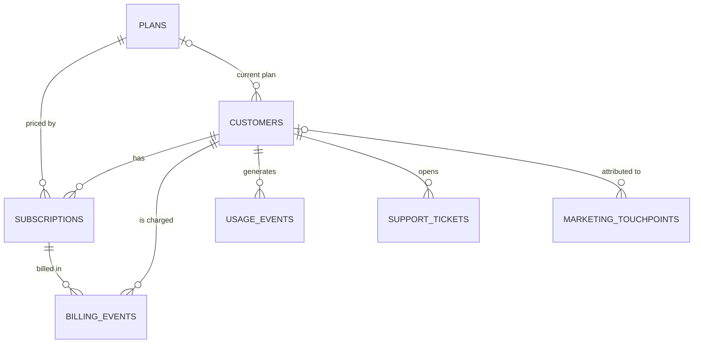

# UpCloud Data Model

> **Note:** UpCloud is a fictional company. All data is synthetic and produced by the generator in `data_generator/`.

This document defines the seven source tables that the pipeline ingests. For each table it states the grain, primary key, foreign keys, columns with types, and the event timestamp. The six design decisions that shape the model are explained at the end.

## 1. Overview

| Table | One row represents... | Source system it mimics | Event timestamp |
|---|---|---|---|
| `plans` | A plan at one price for one billing cycle (a price version) | Billing system | `valid_from` |
| `customers` | A customer workspace | CRM / app database | `signup_at` |
| `subscriptions` | One customer on one plan version for one continuous period | Billing system | `started_at` |
| `billing_events` | One charge attempt for one invoice (billing period) of a subscription row | Payment provider | `attempted_at` |
| `usage_events` | One customer, one event type, one UTC day (with a count) | Product analytics | `event_day` |
| `support_tickets` | One support ticket | Helpdesk | `created_at` |
| `marketing_touchpoints` | One interaction between a visitor or customer and a marketing channel | Marketing tools | `touched_at` |

### Relationships

### Global conventions

- **IDs:** UUIDs (`VARCHAR(36)`) everywhere, except `plans`, which uses short readable codes (`p001`). IDs issued by an outside system, such as `invoice_id` from the payment provider, keep that system's format.
- **Timestamps:** UTC, ISO 8601 with a `Z` suffix, stored as `TIMESTAMP` (example: `2026-03-14T09:30:00Z`).
- **Open-ended periods** end at `9999-01-01T00:00:00Z`.
- **Ranges** are start-inclusive and end-exclusive: a row is valid for `valid_from <= t < valid_to`.
- **Money:** `DECIMAL(10,2)` in euros, never `FLOAT`.
- **Categorical values** are lowercase, trimmed, and use underscores (`organic_search`, not `Organic Search`).
- **Pipeline metadata:** every bronze table gets `_ingested_at` (TIMESTAMP) and `_source_file` (VARCHAR), added by the pipeline at load time. They are not source columns and are not listed in the table definitions.

---

## 2. Tables

### 2.1 plans

**Source system it mimics:** billing system
**Grain:** one row = one plan at one price for one billing cycle. A price change creates a new row; old rows are kept.
**Primary key:** `plan_id`
**Foreign keys:** none (reference table)
**Event timestamp:** `valid_from`, the moment the price version takes effect

| Column | Type | Notes |
|---|---|---|
| plan_id | VARCHAR | PK, readable code such as `p001` |
| plan_name | VARCHAR | Tier name: `Free`, `Bronze`, `Silver`, `Gold` (same name across versions and billing cycles) |
| price_eur | DECIMAL(10,2) | Price per billing cycle |
| billing_cycle | VARCHAR | `monthly` or `annual` |
| target_customer | VARCHAR | Short description of the intended customer |
| valid_from | TIMESTAMP | Event timestamp, inclusive |
| valid_to | TIMESTAMP | Exclusive; `9999-01-01T00:00:00Z` for the current version |

Annual prices are 10 times the monthly price (two months free). The price increase on 2026-03-01 raised Silver and Gold by 25% (Silver €64 → €80, Gold €120 → €150), monthly and annual.

| plan_id | plan_name | price_eur | billing_cycle | target_customer| valid_from | valid_to |
|---|---|---|---|--- |---|---|
| p001 | Free | 0.00 | monthly | individuals | 2024-11-01T00:00:00Z | 9999-01-01T00:00:00Z |
| p002 | Bronze | 25.00 | monthly | small teams | 2024-11-01T00:00:00Z | 9999-01-01T00:00:00Z |
| p003 | Silver | 64.00 | monthly | team needing automation | 2024-11-01T00:00:00Z | 2026-03-01T00:00:00Z |
| p004 | Gold | 120.00 | monthly | admin and security features | 2024-11-01T00:00:00Z | 2026-03-01T00:00:00Z |
| p005 | Bronze | 250.00 | annual | small teams | 2024-11-01T00:00:00Z | 9999-01-01T00:00:00Z |
| p006 | Silver | 640.00 | annual | team needing automation | 2024-11-01T00:00:00Z | 2026-03-01T00:00:00Z |
| p007 | Gold | 1200.00 | annual | admin and security features | 2024-11-01T00:00:00Z | 2026-03-01T00:00:00Z |
| p008 | Silver | 80.00 | monthly | team needing automation | 2026-03-01T00:00:00Z | 9999-01-01T00:00:00Z |
| p009 | Gold | 150.00 | monthly | admin and security features | 2026-03-01T00:00:00Z | 9999-01-01T00:00:00Z |
| p010 | Silver | 800.00 | annual | team needing automation | 2026-03-01T00:00:00Z | 9999-01-01T00:00:00Z |
| p011 | Gold | 1500.00 | annual | admin and security features | 2026-03-01T00:00:00Z | 9999-01-01T00:00:00Z |

`valid_to` is the last moment a price version can be assigned to new subscriptions. Existing customers stay on their version until a `price_increase` row moves them.

### 2.2 customers

**Source system it mimics:** CRM / app database
**Grain:** one row = one customer workspace (one company account). Plan history lives in `subscriptions`, not here.
**Primary key:** `customer_id`
**Foreign keys:** `current_plan_id` → plans
**Event timestamp:** `signup_at`, the moment the workspace was created

| Column | Type | Notes |
|---|---|---|
| customer_id | VARCHAR(36) | PK, UUID |
| workspace_name | VARCHAR | Company or team name |
| country_code | CHAR(2) | ISO 3166-1 alpha-2, e.g. `DE`, `FR`. Nullable (missing values are injected as noise, see section 5) |
| industry | VARCHAR | e.g. `software`, `agency`, `consulting` |
| team_size | INTEGER | Seats at signup (5-50 for paying customers) |
| acquisition_channel | VARCHAR | `organic_search`, `paid_ads`, `referral`, `partnership` |
| current_plan_id | VARCHAR | FK → plans. **Denormalized and derived** from the open row in `subscriptions`; NULL once the subscription is cancelled |
| signup_at | TIMESTAMP | Event timestamp, UTC |
| updated_at | TIMESTAMP | Last change to the row; used for incremental loads |

`subscriptions` is the source of truth for plans. `current_plan_id` exists for convenience and is checked against it by the pipeline (see section 4).

### 2.3 subscriptions

**Source system it mimics:** billing system
**Grain:** one row = one customer on one plan version for one continuous period.
**Primary key:** `subscription_id`
**Foreign keys:** `customer_id` → customers, `plan_id` → plans
**Event timestamp:** `started_at`

| Column | Type | Notes |
|---|---|---|
| subscription_id | VARCHAR(36) | PK, UUID |
| customer_id | VARCHAR(36) | FK → customers |
| plan_id | VARCHAR | FK → plans (the exact price version) |
| change_type | VARCHAR | Why this period began: `new`, `upgrade`, `downgrade`, `price_increase`, `reactivation` |
| started_at | TIMESTAMP | Event timestamp, UTC, inclusive |
| ended_at | TIMESTAMP | Exclusive; `9999-01-01T00:00:00Z` while open |
| end_reason | VARCHAR | `plan_change`, `cancellation`, or NULL while open |
| updated_at | TIMESTAMP | Needed because `ended_at` is edited when a period closes |

### 2.4 billing_events

**Source system it mimics:** payment provider
**Grain:** one row = one charge attempt for one invoice (billing period) of a subscription row. One subscription row can span many invoices.
**Primary key:** `billing_event_id`
**Foreign keys:** `customer_id` → customers, `subscription_id` → subscriptions
**Event timestamp:** `attempted_at`

| Column | Type | Notes |
|---|---|---|
| billing_event_id | VARCHAR(36) | PK, UUID |
| invoice_id | VARCHAR | Groups all attempts to collect the same bill; assigned by the payment provider (there is no invoices table) |
| customer_id | VARCHAR(36) | FK → customers |
| subscription_id | VARCHAR(36) | FK → subscriptions (the period being charged) |
| amount_eur | DECIMAL(10,2) | Amount charged |
| attempt_number | INTEGER | 1 for the first try, 2 for the first retry, etc. |
| status | VARCHAR | `succeeded` or `failed`: the outcome of this attempt |
| failure_reason | VARCHAR | NULL if succeeded: `card_declined`, `insufficient_funds`, `expired_card` |
| billing_period_start | TIMESTAMP | Which period the charge pays for, UTC |
| attempted_at | TIMESTAMP | Event timestamp, UTC |

Assumptions: the Free plan generates no billing events; monthly plans are charged every month and annual plans every 12 months; there is no proration, so a new plan is charged from the next billing date. Failed charges follow the dunning policy in section 3.7.

### 2.5 usage_events

**Source system it mimics:** product analytics
**Grain:** one row = one customer, one event type, one UTC day, with a count. Rows exist only on days when that event type happened at least once.
**Primary key:** `usage_event_id`, plus a unique constraint on (`customer_id`, `event_type`, `event_day`) so reloads cannot create duplicates
**Foreign keys:** `customer_id` → customers
**Event timestamp:** `event_day`, the start of the UTC day

| Column | Type | Notes |
|---|---|---|
| usage_event_id | VARCHAR(36) | PK, UUID |
| customer_id | VARCHAR(36) | FK → customers |
| event_type | VARCHAR | One of the five types below |
| event_day | TIMESTAMP | Event timestamp: UTC day bucket, truncated to midnight |
| event_count | INTEGER | How many times it happened that day |
| active_users | INTEGER | Distinct people in the workspace who did it that day |

| event_type | Business question it helps answer |
|---|---|
| `session_started` | Is the customer engaged or going quiet (a churn signal)? |
| `project_created` | Are they setting up and growing their use? |
| `task_completed` | Are they getting real value from the product? |
| `member_invited` | Is the team growing (a likely upgrade signal)? |
| `automation_run` | Are they using the Silver-tier feature? |

The plan a customer was on is not stored here. A day belongs to the plan that was active at the last instant of that UTC day: join to `subscriptions` where `started_at < event_day + 1 day AND ended_at >= event_day + 1 day`. This way, usage on the day a customer signs up or changes plan is not lost.

### 2.6 support_tickets

**Source system it mimics:** helpdesk
**Grain:** one row = one support ticket (one request from one customer), updated as it progresses.
**Primary key:** `ticket_id`
**Foreign keys:** `customer_id` → customers
**Event timestamp:** `created_at`

| Column | Type | Notes |
|---|---|---|
| ticket_id | VARCHAR(36) | PK, UUID |
| customer_id | VARCHAR(36) | FK → customers |
| category | VARCHAR | `billing`, `bug`, `how_to`, `feature_request`, `account_access` |
| priority | VARCHAR | `low`, `normal`, `high`, `urgent` |
| status | VARCHAR | `open`, `pending`, `resolved`, `closed` (current status) |
| created_at | TIMESTAMP | Event timestamp, UTC |
| first_response_at | TIMESTAMP | NULL until support replies |
| resolved_at | TIMESTAMP | NULL until resolved |
| satisfaction_score | INTEGER | 1-5 survey score, NULL if not answered |
| updated_at | TIMESTAMP | Last change, used for incremental loads |

### 2.7 marketing_touchpoints

**Source system it mimics:** marketing tools
**Grain:** one row = one interaction between a visitor or customer and a marketing channel.
**Primary key:** `touchpoint_id`
**Foreign keys:** `customer_id` → customers (nullable)
**Event timestamp:** `touched_at`

| Column | Type | Notes |
|---|---|---|
| touchpoint_id | VARCHAR(36) | PK, UUID |
| visitor_id | VARCHAR | Anonymous ID from the marketing tool |
| customer_id | VARCHAR(36) | FK → customers, NULL until the visitor signs up |
| channel | VARCHAR | `organic_search`, `paid_ads`, `referral`, `partnership` |
| campaign | VARCHAR | Campaign name, NULL for organic traffic |
| touchpoint_type | VARCHAR | `visit`, `click`, `signup` |
| cost_eur | DECIMAL(10,2) | Cost of this touch, mostly for paid ads, otherwise NULL |
| touched_at | TIMESTAMP | Event timestamp, UTC |

---

## 3. Design decisions

### 3.1 Plan changes: a new row per change

`subscriptions` never updates a row in place when a customer changes plan. An upgrade or downgrade closes the current row (`end_reason = 'plan_change'`) and opens a new one with the matching `change_type`. A cancellation closes the current row with `end_reason = 'cancellation'` and opens nothing. If the customer later returns, a new row with `change_type = 'reactivation'` opens. The gap between the two rows is the period the customer was churned.

This is what the MRR bridge needs. Each period's MRR is the monthly equivalent of the plan's `price_eur` (annual price / 12), computed in dbt. So every bridge component can be traced to rows:

| Bridge component | Where it comes from |
|---|---|
| New | `change_type = 'new'` on a paid plan |
| Expansion | `upgrade`, price difference vs the previous row |
| Contraction | `downgrade`, same |
| Price increase | `price_increase` rows (monthly customers: March 2026; annual customers: their renewal date, March 2026 to February 2027) |
| Churn | `end_reason = 'cancellation'` |
| Reactivation | `change_type = 'reactivation'` (a win-back, not a new customer) |

Free has MRR of €0, so a free-to-paid conversion is an upgrade.

**Pros:** full history, MRR for any past month, every bridge component is traceable. **Cons:** more rows, deltas need a join or `LAG()`, and "current state" needs a filter on the open row. Overlapping or gapped periods for one customer are possible after a bad load, so the pipeline checks for them. One row per customer updated in place would be simpler but overwrites the old value, so a past month's bridge could not be reproduced.

### 3.2 Failed payments: one row per attempt

"Charge failed, retried 3 days later, succeeded" is stored as two rows that share an `invoice_id`:

| invoice_id | attempt_number | status | failure_reason | attempted_at |
|---|---|---|---|---|
| inv_104 | 1 | failed | card_declined | 2026-04-01T06:00:00Z |
| inv_104 | 2 | succeeded | NULL | 2026-04-04T06:00:00Z |

`status` is the outcome of each attempt, and the outcome of the invoice is the status of its last attempt. One row per invoice would lose the retry timing and failure reasons needed to measure recovery rates.

### 3.3 Price increase: old prices stay in `plans`

A price change closes the old row (`valid_to` = the change date) and adds a new row. The old price therefore lives in the closed row (e.g. p003, Silver at €64), and subscriptions keep pointing at the exact version they were charged under. Existing Silver and Gold customers are moved to the new price by a `price_increase` row in `subscriptions` that starts on their first billing date on or after 2026-03-01. Monthly customers pay the new price from their March 2026 billing date (they were notified in advance), and annual customers keep the old price until their renewal date.

### 3.4 Usage events: customer, event type and day

One row per click would be billions of rows. One row per customer per day would hide which features a customer uses, for example a Bronze customer starting to use automation before upgrading. One row per customer, event type and day keeps that signal, and because rows exist only when something happened, the table stays small. The five event types are listed in section 2.5.

### 3.5 IDs: UUIDs, except for `plans`

Sequential integers collide when two source systems each generate their own IDs, since both would create a customer `1`, and merging them would need an extra source-system column and a new key. UUIDs are unique without coordination. The cost is readability, so `plans` (a tiny reference table maintained by hand) keeps short codes like `p001`. The generator creates UUIDs from a seeded random generator so the same seed always produces the same data. IDs issued by an external system, such as `invoice_id`, are kept as given.

### 3.6 Timestamps: UTC, ISO 8601

Every timestamp is stored in UTC as ISO 8601 with a `Z` suffix (`2026-03-14T09:30:00Z`). Customers span several European time zones and daylight-saving changes, so conversion to local time happens only in reports. Daily buckets are midnight UTC, open-ended periods end at `9999-01-01T00:00:00Z`, and ranges are start-inclusive and end-exclusive.

### 3.7 Voluntary vs involuntary churn (derived, not stored)

`subscriptions.end_reason = 'cancellation'` says that a subscription ended, not why. The reason is derived from `billing_events`.

- **Dunning policy (assumption):** a failed charge is retried on day +3 and day +7 after the first failed attempt (at most 3 attempts per invoice). If no attempt succeeds, the subscription is cancelled on day +14.
- **Involuntary churn:** the subscription's last invoice has no `succeeded` attempt and `date(ended_at) = date(first failed attempt) + 14 days`.
- **Voluntary churn:** every other cancellation. A customer who cancels during the dunning window ends before day +14 and is therefore voluntary.
- The generator records the true reason in the ground-truth file (section 6), and the derivation must match it.

---

## 4. Data quality checks for the pipeline

| Table | Check |
|---|---|
| plans | `valid_from < valid_to`; no two versions of the same plan name and billing cycle overlap |
| customers | `current_plan_id` equals the `plan_id` of the customer's open subscription |
| customers | `acquisition_channel` matches the channel of the customer's first touchpoint |
| subscriptions | No overlapping periods; at most one open row per customer; a gap between two rows is allowed only if the earlier row has `end_reason = 'cancellation'` and the next has `change_type = 'reactivation'` |
| billing_events | `amount_eur` equals the `price_eur` of the plan on the linked subscription |
| billing_events | `attempt_number` starts at 1 and increases by 1 within an `invoice_id`; maximum 3 attempts per invoice |
| usage_events | No rows before the day the customer signed up (`event_day >= date_trunc('day', signup_at)`); unique on (`customer_id`, `event_type`, `event_day`); `event_count >= active_users` |
| support_tickets | `first_response_at >= created_at`; `resolved_at >= first_response_at`; `resolved_at` is NULL while status is open or pending |

---

## 5. Planned data quality issues

Real source data is messy. After the generator produces clean data, a separate noise step will inject the five problems below. Cleaning them is the job of the silver layer. The injection is seeded, so the same seed always produces the same mess, and every injected row is recorded in a ground-truth log (`data_generator/noise_log.csv`) so the silver layer can be tested against what it should fix.

| # | Table / column | Problem injected | Approx. share of rows | How the silver layer fixes it |
|---|---|---|---|---|
| 1 | `billing_events` | **Duplicate rows:** the payment provider resends an event, creating a second row with a new `billing_event_id` but the same `invoice_id` and `attempt_number` | 1-2% | Deduplicate on (`invoice_id`, `attempt_number`), keeping the row with the earliest `_ingested_at` (tie-break: smallest `billing_event_id`). Log how many were removed |
| 2 | `customers.country_code` | **Missing values:** a mix of NULL and empty strings (`''`) | 3% | Convert empty strings to NULL and add a boolean `country_missing` flag. Keep `country_code` NULL (CHAR(2) cannot hold `unknown`). The country cannot be guessed, so it is not imputed |
| 3 | `support_tickets.created_at` (and the other timestamp columns) | **Two timestamp formats:** most rows follow the convention (`2026-03-14T09:30:00Z`), but some come from a legacy export as `2026-03-14 09:30:00` (no `T`, no `Z`) | 5% | Parse both formats, treat the legacy one as UTC (documented assumption), and write everything back as ISO 8601 UTC |
| 4 | `usage_events.customer_id` | **ID formatting errors:** upper-case UUIDs or trailing spaces, so the value no longer matches `customers.customer_id` | 2% | Trim whitespace and lower-case the ID, then re-check the foreign key. Rows that still don't match go to a quarantine table |
| 5 | `customers.current_plan_id` | **Stale derived value:** the column still shows the previous plan after the customer changed plans, so it disagrees with the open row in `subscriptions` | 2% | Recompute `current_plan_id` from `subscriptions` (the source of truth) and report the mismatch rate |

Each problem is caught by a check in section 4 or by a rule in the silver layer:

- Problem 1 breaks the `attempt_number` check.
- Problem 3 breaks the timestamp convention.
- Problem 4 breaks the foreign key check.
- Problem 5 breaks the `current_plan_id` reconciliation.
- Problem 2 is found by a NULL-rate check on `country_code`.

## 6. Ground truth (not loaded into the pipeline)

Besides the source tables, the generator writes files under `data_generator/ground_truth/` that are **never ingested**. They exist only to validate the analysis.

- `churn_reasons.csv`: `customer_id`, `churned_at`, `churn_type` (`voluntary` or `involuntary`), `primary_driver` (`low_usage`, `payment_failure`, `price_increase`, `poor_fit_channel`, `other`).
- The pipeline's derived churn type (section 3.7) must match `churn_type` exactly, and the analysis must recover the planted drivers.

## 7. Data volume and time window

- **Time window:** the company launches on 2024-11-01. Data covers 2024-11-01 to 2026-10-31 (24 months), and the price increase falls inside it.
- **Default size:** 10,000 customers. The generator is configurable with `--customers`, `--start`, `--end` and `--seed`, so larger runs are optional.